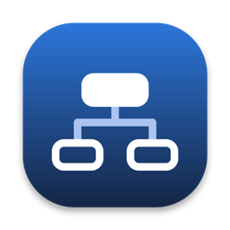

  

Flutter UI Builder
==================

**Design Flutter screens by dragging widgets, and get the Dart code.**

Desktop app for macOS, Windows and Linux.

### [Download](https://github.com/mariorefetto/flutter_ui_builder/releases) | [Install](#install) | [Report a problem](https://github.com/mariorefetto/flutter_ui_builder/issues)

Features
--------

---

- Drag and drop about 90 Material and Cupertino widgets onto the canvas or the outline
- Placement rules that wrap a widget where it needs a parent
- Properties panel with a tooltip for every property, color and icon pickers
- Several screens, with navigation by push or by route name
- Reusable components with parameters
- Project theme, light and dark, and themes for the widgets
- Device frames with status bar and safe area, zoom and guidelines
- Sample data for lists and grids, and a prototype mode with live controls
- Live Dart code with syntax highlighting; edit it and apply it back to the design
- Import existing Dart files, even with several widget classes
- Export the whole project as Dart files
- Projects saved as JSON files
- English and Italian
- Tells you when a new version is out

Install
-------

Download the file for your system from the
[releases page](https://github.com/mariorefetto/flutter_ui_builder/releases)
and check it against `SHA256SUMS.txt`.

| System  | File                              | First start                                                      |
| ------- | --------------------------------- | ---------------------------------------------------------------- |
| macOS   | `FlutterUIBuilder-…-macos.zip`    | Unzip, then right click the app and choose Open                  |
| Windows | `FlutterUIBuilder-…-windows.zip`  | Unzip and run the `.exe`; if SmartScreen warns, More info, Run anyway |
| Linux   | `FlutterUIBuilder-…-linux.tar.gz` | Extract and run `flutter_ui_builder`; file dialogs need `zenity` or `kdialog` |

The builds are not signed yet, which is why macOS and Windows ask for
confirmation the first time. Only macOS and Windows have been tried by hand.

### Updates

At startup the app asks GitHub whether a newer version is out, and shows a
notice in the status bar if so. It sends nothing but the request itself. Turn
it off in Settings, or check by hand from Help, Check for updates.

Your projects and the code you export
-------------------------------------

Your projects are never sent anywhere; the only thing the app asks the
network for is the update check above. The code it generates for your
projects is yours.

Notice
------

Copyright (c) 2026 Mario Refetto.

Flutter UI Builder is source-available under the
[PolyForm Noncommercial License 1.0.0](LICENSE): free for personal use,
research, education and hobby projects, not for commercial use without the
author's permission. It is not an open source license in the sense of the Open
Source Initiative, because it limits commercial use.

It uses packages from pub.dev under the MIT, BSD-3 and Apache-2.0 licenses,
and `dbus` (on Linux only) under the MPL-2.0. The icons come from
`lucide_icons_flutter` (MIT).

Bug reports and ideas are welcome in the
[issues](https://github.com/mariorefetto/flutter_ui_builder/issues).
